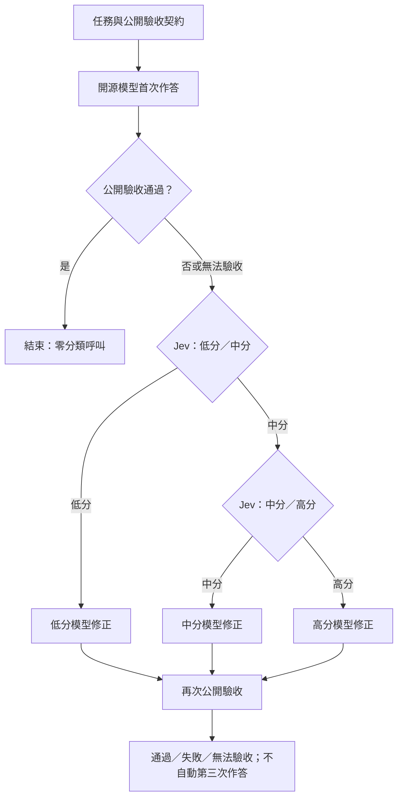

# CloudyFan Jev Core

獨立的 Python model-routing 核心：**開源模型先答，以公開契約驗收；需要補救時，Jev 依序做「低／中」、「必要時中／高」二選一，最後只呼叫一次被選中的模型作修正。**

此 repo 從 2026-10-18 的 CloudyFan 新階層實驗抽出，不依賴原工作區、舊 `cloudyfan` 套件或實驗答案。舊 Jev A/B、alpha/beta 保留在原專案，沒有被覆寫。

新增的[評分資料層](docs/score-integration.md)可接入 LiveBench、AA／OpenRouter benchmark API 與經審閱的 CodexRadar 匯入，建立高／中／低模型池，再以 `ScoreCore` 將候選與快照固定到單一任務。快速離線驗證：`uv run cloudyfan-score-demo --route high`。來源接入不代表候選已完成生產資格確認。

## 實作與文件入口

[主規格 #1 實作索引](docs/implementation-spec1.md)列出 T01～T12 的功能、使用文件、離線驗收與正式接入缺口。[完整驗證紀錄](docs/verification.md)保留各輪檢查。

[統一驗證入口](docs/checks.md)提供本機與 CI 共用命令；[跨接入契約矩陣](docs/transport-contracts.md)檢查 HTTP／Ollama／Queue 的共同保證。[正式放行索引](docs/release-readiness.md)分開記錄離線實作完成與正式資格。

## 流程



第二次分類之前不生成中模型答案。模型分數與 Jev 選項分布都不是答對機率。驗收器必須依任務契約客觀判定；模型自稱正確不能取代驗收。

## 安裝與零費用示範

Python 3.12+，macOS／Linux（檔案鎖使用 POSIX `fcntl`）。

```bash
./scripts/check --integration
uv run cloudyfan-jev-demo --route pass
uv run cloudyfan-jev-demo --route low
uv run cloudyfan-jev-demo --route mid
uv run cloudyfan-jev-demo --route high
```

示範使用 `httpx.MockTransport`，**不讀 API key、不連 API、不產生真實費用**。輸出的 `simulated_costs` 是測試資料，`real_api_cost_usd` 為零。證據寫入被 Git 忽略的 `runtime/`。

驗證入口使用 `uv.lock` 與專案 `.venv`。初次缺少依賴快取時會停止；需連網的依賴準備與純離線驗證分開，詳見[驗證說明](docs/checks.md)。應用安裝仍可使用 `python -m pip install -e '.[dev]'`，但驗證統一使用上述入口。

## 整合介面

```python
import json
import httpx
from pathlib import Path
from cloudyfan_jev import Core
from cloudyfan_jev.client import Client
from cloudyfan_jev.ledger import summarize

config = json.loads(Path("your-qualified-profiles.json").read_text())
# api_key 由應用的憑證管理提供；不要寫進程式或 Git。
# 只有使用一般 httpx.Client 的 Client.call 會呼叫真實 API。
with httpx.Client() as http:
    client = Client(http, api_key, Path("runtime/customer-job"))
    core = Core(client, config["profiles"], config["decision"])
    result = core.run(
        "job-001",
        {"prompt": public_prompt, "input_sha256": input_digest},
        make_fresh_isolated_environment,
        contract_version="my-public-contract-v1",
    )
    ledger = summarize(client)  # 包含已完成、失敗與中斷流程的全部呼叫
```

`make_fresh_isolated_environment()` 每次都必須產生**全新、隔離且可重播**的工作區，並提供：

- `tools_schema() -> list[dict]`：Chat Completions 工具 schema。
- `call(name, arguments) -> dict`：應用自行限制工具權限、路徑與執行資源；core 不提供任意 shell。
- `validate(final_text) -> dict`：至少含 `passed: True | False | None`，可附公開失敗診斷。`None` 是無法驗收，不是成功。

`task` 需包含 prompt 與所有輸入的內容或雜湊；工具、驗收規則、工作區準備方式改變時必須更新 `contract_version`。額外 task 欄位用於凍結識別；模型取得的是 `prompt` 與工具資料，所以 prompt 應明確列出可讀輸入。

`examples/profiles.experimental-20261018.json` 是**有日期的歷史配置**，不是目前可用性、價格或新任務能力保證。它包含當時的公開校準能力卡，沒有正式題答案；新任務應另做資格確認，再凍結配置。Core 不會查榜單、自動換模型或按正式結果調門檻。

## 模組

|模組|責任|
|---|---|
|`routing.py`|二層二選一、公開資料投影、保守 fallback 與選擇原因|
|`decisions.py`|Jev Decisions payload、嚴格回應解析、分布容忍度、可核對費用證據|
|`engine.py`|最多兩次生成階段、工具往返、驗收、修正、四種流程、續跑|
|`client.py`|OpenRouter Chat／Decisions、intent 與回答保存、禁止自動重送、GET 核帳|
|`ledger.py`|全部 durable 呼叫的成本摘要，保留中斷與未知|
|`demo.py`|完全離線的 pass／low／mid／high 路徑示範|
|`scores/`|評分來源 adapters、原生尺度分群、快照、資格檢查與單任務 `ScoreCore` 綁定|

`Core.run(mode=...)` 支援 `cloudyfan`、`fixed_high`、`low_first`、`open_source_first`。後三者保留實驗基準：失敗直接最高配置補救；`fixed_high` 使用同最高配置修正。這些是可選工作流程，並非自動重新跑比較實驗。

## 費用與續跑契約

- 每個 POST 之前先保存 intent，回應先落盤再解析；同 run/call ID 與相同設定重用原回應，設定不同拒絕續跑。
- 有 intent 卻沒有完整回應時，不重送付費請求。未知費用或 generation identity 會阻止後續新 POST；可明確呼叫 `client.reconcile(call_id)` 對同 generation 做 GET 核帳。
- 實付使用 `usage.cost`；可取得時以 `generation.total_cost` 取代，**不相加**。已包含的路由費不重複計價。核帳後也重新核對結果模型及供應商。
- 修正保留公開對話與工具結果；跨生成階段移除 reasoning／reasoning_details，同一階段工具往返則保留。
- 已完成 workflow 不重播工具；中斷流程用新 sandbox 重播已記錄的 deterministic local actions。不可用此方式重播寄信、付款、部署等外部副作用。
- `result["costs"]` 是單流程摘要；發生例外時要用 `summarize(client)` 讀全帳，不能只加總成功結果。未知總費用回傳 `None`。
- `hypothetical_open_source_zero_usd` 只是歸零開源生成 API 費的情境；真實 API 費仍保留。本 repo 已有本地 loopback 文字協定 adapter 與量測流程；Mac Studio 真實模型、容量與本機延遲仍未實測。
- 裸 `Core` 不代表付費授權；[BudgetedCore](docs/budget-admission.md)提供有效授權、完整流程預留與帳務控制，但正式供應商上限驗證器仍需應用提供，缺少時停止。token 上限不是美元上限。
- 格式壞掉的工具呼叫、傳輸或身份異常是工程中斷，保存收據後停止；不是假裝模型答錯再無限重試。空回答／token 耗盡則由相同公開驗收決定唯一修正機會。

## 驗證程度與資料邊界

這是已抽取並離線驗證的核心，不是已部署 SaaS。原25題實測、3題契約歧義、22題後驗敏感度與第二層未正式觸發等限制，見 [實驗證據摘要](docs/evidence.md)。搬移後沒有新增付費測試；mock 路徑測試不能冒稱新的實測降本。

Runtime receipts 含使用者 prompt／答案，預設寫入 private permissions，但仍應視為敏感資料。Git 只納入原始碼、合成測試、文件、歷史配置與來源雜湊，不納入 API key、原始實驗答案或帳本。

目前為本機 repository，未選擇公開授權、未發布到 PyPI 或 GitHub。來源與抽取差異見 [provenance](docs/provenance.md)。
